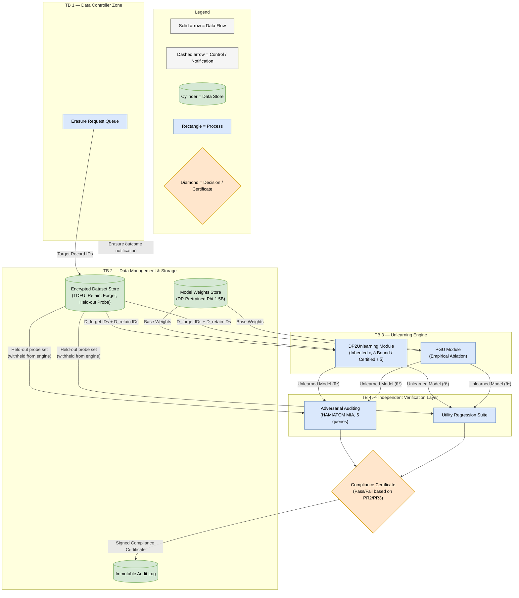
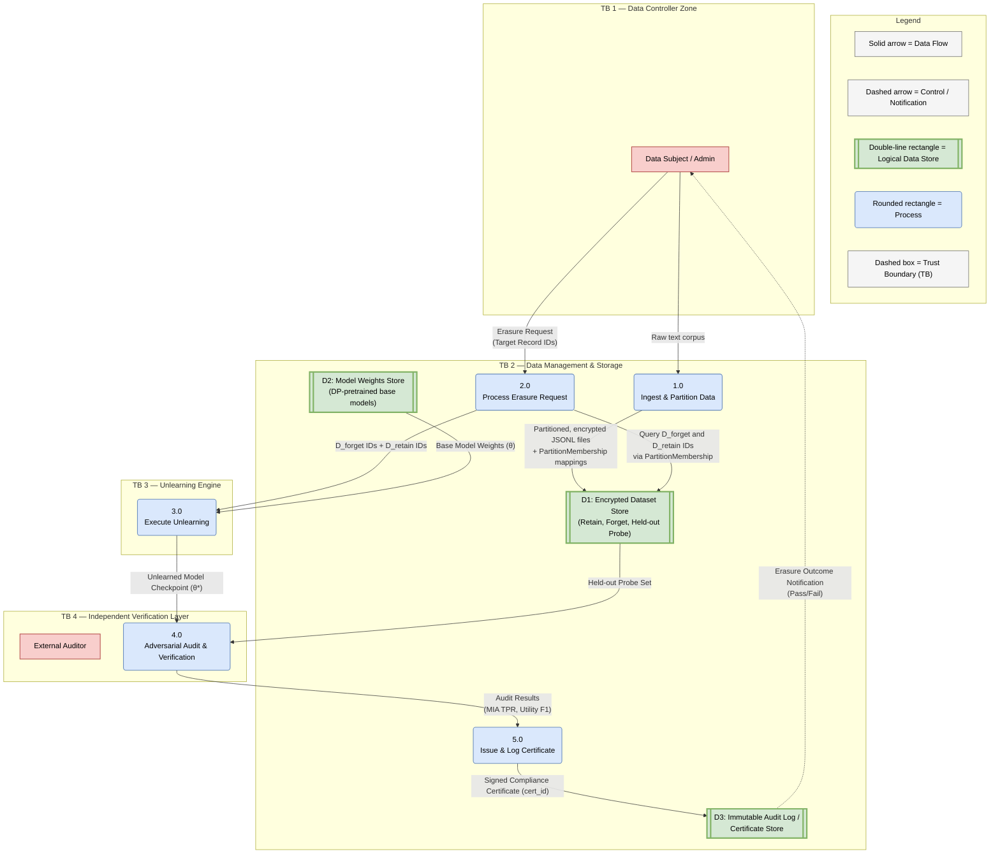
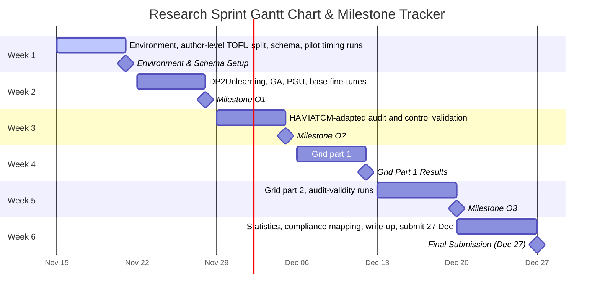

# Abstract

**Context:** Enterprise large language models (LLMs) ingest sensitive text data, creating strict statutory erasure obligations under frameworks like the GDPR and Malaysia's PDPA. **Problem:** Current machine unlearning solutions rely on approximate methods that leave residual parametric traces, creating an "illusion of forgetting" vulnerable to black-box Membership Inference Attacks (MIAs), while lacking independent, architecturally enforced verification. **Aim and Proposed Design:** This proposal aims to design and evaluate a verifiable machine unlearning data-management pipeline. The architecture integrates certified DP2Unlearning with an independent, black-box adversarial auditing module (adapted from HAMIATCM) operating across strict data-management trust boundaries to empirically verify erasure. **Evaluation Plan:** The pipeline will be evaluated using the public TOFU benchmark on a Phi-1.5B model against exact retraining and heuristic gradient ascent baselines. Performance will be measured via empirical privacy leakage (MIA True Positive Rate at 1% False Positive Rate), downstream utility (F1-score retention), and computational efficiency, analyzed using Wilcoxon signed-rank tests across six random seeds. **Expected Contribution:** The research will produce an open-source, compliance-ready pipeline that transforms statutory erasure from an opaque heuristic assertion into a verifiable, evidence-based data governance workflow, bridging formal differential privacy bounds with empirical adversarial resistance.

**Keywords:** Large Language Models; Machine Unlearning; Differential Privacy; Membership Inference Attacks; Data Governance; Privacy-Enhancing Technologies; Regulatory Compliance.

# Introduction

The rapid integration of Large Language Models (LLMs) into enterprise environments has introduced significant data management and privacy engineering challenges. Organizations increasingly fine-tune foundation models on sensitive text-based records, such as medical transcripts and financial logs. Under GDPR Art. 17, data subjects may obtain erasure on listed grounds, including withdrawal of consent (Art. 17(1)(b)). Malaysia's PDPA 2010 withdrawal of consent (s.38) and the Retention Principle (s.10) create analogous obligations to cease processing and not retain data longer than necessary. However, neural sequence models memorise training instances, so complete removal is computationally and mathematically difficult [12], [15], [16].

To comply with erasure mandates without incurring the prohibitive costs of exact retraining, enterprises rely on machine unlearning techniques. While certified methods like DP2Unlearning provide formal differential privacy (DP) guarantees [12], they are computationally intensive. Consequently, approximate unlearning methods, such as gradient ascent or preference optimization, are frequently deployed for their efficiency [13], [14]. The critical problem is that current data-management solutions lack rigorous, independent verification of approximate unlearning, and surveys identify this as unresolved [15], [16]. Output-level suppression can leave residual traces, and membership-inference attacks such as HAMIATCM [5] show that minimal-knowledge, shadow-free probing is feasible against text models. Whether such probes transfer to unlearned generative models is an open question that this proposal tests. The consequence is regulatory exposure (GDPR Art. 83(5) fines of up to 4% of turnover or €20M), privacy loss for data subjects and reputational damage.

The aim of this research is to design and evaluate a verifiable machine-unlearning data-management pipeline for text-based systems that produces independent, measurable evidence of forgetting target records, without degrading downstream utility beyond a stated tolerance.

The primary contributions of this proposal are:

1. The design of an end-to-end data-management architecture that integrates certified unlearning (DP2Unlearning) with an independent, adversarial auditing module utilizing low-query black-box MIAs.
2. The formulation of a formal threat model and Privacy-Enhancing Technology (PET) placement strategy that maps mathematical forgetting bounds to statutory erasure workflows.
3. A rigorous, reproducible evaluation framework using the TOFU benchmark to quantify utility retention, empirical privacy leakage, and computational efficiency against established baselines.

The remainder of this proposal is organized as follows: Section 2 synthesizes the background and identifies the research gap. Section 3 defines the problem statement, aim, objectives, and hypotheses. Section 4 details the proposed system design, including architecture, data models, and threat modeling. Section 5 outlines the research methodology and evaluation plan. Sections 6 and 7 discuss expected outcomes, ethical, legal, and risk considerations. Section 8 presents the preliminary timeline, and Section 9 concludes the proposal.

# Background and Research Gap

The post-deployment phase of the enterprise large language model (LLM) lifecycle is increasingly dominated by the challenge of statutory data erasure, particularly the enforcement of data retention and deletion policies mandated by frameworks such as the GDPR and Malaysia's PDPA. Machine unlearning seeks to remove the influence of specific data points from a trained model, serving as the technical mechanism for this erasure. Recent literature categorizes unlearning approaches into certified methods, which offer formal mathematical guarantees, and approximate methods, which prioritize computational efficiency but often lack rigorous verification.

DP2Unlearning [12] uses differentially private training to give an (ε, δ)-DP forgetting guarantee, with unlearning by fine-tuning on retain data only, at roughly half the cost of retraining. APA [13] achieves exact unlearning for LLM-based recommenders by partitioning data across adapters and retraining only affected shards. SRRS [14] is an approximate method that combines supervised fine-tuning and reinforcement learning for sequential unlearning requests. Surveys [15], [16] note that approximate methods often suffer utility degradation or incomplete erasure, and that verification of erasure remains an open problem. Black-box MIAs such as HAMIATCM [5] (82.4% F1 with five queries and no shadow model, on text classifiers) suggest a low-cost way to probe residual memorisation, but, to my knowledge, they have not been validated on unlearned generative models. This proposal therefore adapts and validates one (Sec 5.5).

Table 2.1 compares the closest existing solutions in the domain of machine unlearning, evaluated against the criteria of data-management approach, privacy-enhancing technologies (PETs), and empirical privacy measurement.

Table 2.1: Comparison of Closest Solutions in Machine Unlearning

|  |  |  |  |  |  |
| --- | --- | --- | --- | --- | --- |
| **Reference** | **Data-Management Approach** | **PET Used** | **Dataset** | **Privacy Measured (Yes/No & How)** | **Key Limitation** |
| Al Mahmud et al. [12] | Purely ML optimization; no independent audit pipeline | DP2Unlearning (Formal (𝜖, 𝛿)-DP) | Task-specific fine-tuning sets | No empirical privacy attack; forgetting is assessed with ROUGE-L, Truth Ratio and Forget Quality; privacy rests on the inherited DP bound. | Lacks independent, black-box adversarial auditing for regulatory compliance. |
| Hu et al. [13] | Adapter-per-shard data partitioning | Exact unlearning by partition isolation | Amazon Reviews, MovieLens | No (exactness by construction) | Targets recommenders; no adversarial verification; accuracy depends on partition quality |
| Lang et al. [14] | Sequential task adaptation pipeline | SRRS (Approximate, reward-based) | Sequential task datasets | No membership-inference measurement; forgetting efficacy, token entropy and entailment scores only. | Reported evidence is output-level; robustness to membership inference is not evaluated. |
| Gradient Ascent (baseline in [14], [26]) | Ad-hoc script; no lifecycle governance | None (Heuristic) | TOFU and others | Typically output-level metrics | Utility collapse; no independent audit |

## Selected Research Gap

This proposal targets Peer Review Gap G1: the fragility of approximate unlearning and the absence of independent verification of erasure. The evidence is [12]-[14] (unlearning methods with limited or non-adversarial verification) and [15], [16] (surveys that establish taxonomies without resolving verifiable erasure). [5] motivates the audit technique, though it targets text classifiers, not unlearned models.

This gap was selected because it directly addresses the "retention and deletion" stage of the data lifecycle, a core data-management workflow. Unlike pure machine learning accuracy problems, G1 requires a data-management solution that governs how "forget" and "retain" datasets are partitioned, stored, and audited. Furthermore, it is highly feasible to investigate within the six-week prototype scope using the public TOFU (Task of Fictitious Unlearning) benchmark [26] on a Phi-1.5B model via free cloud tiers. Success will be measured against numerical thresholds  (MIA AUC ≤ 0.55 and TPR@1%FPR ≤ 0.05).

## Rejected Gaps

Four other Peer Review gaps were considered and rejected:

* **G2 (utility collapse under strict DP):** Relevant, since it affects ε choice (Sec 5.5), but it is a training-optimisation problem rather than a data-management one.
* **G3 (parameter inversion in federated LLMs):** Requires a multi-client federated setup, which exceeds a six-week prototype.
* **G4 (ICL privacy benchmarking):** Needs commercial API access and dynamic prompt infrastructure.
* **G5 (regulatory translation):** Largely legal analysis with limited measurable engineering content. It is partly addressed here through the compliance-mapping artefact (Sec 6).

## Positioning and Novelty

The proposed design addresses gaps left by the closest studies in the corpus [12]-[16], which do not combine a formal forgetting bound with an architecturally independent adversarial audit inside a governed data lifecycle. Specifically, it responds to the lack of independent adversarial auditing in [12] and the fragile empirical guarantees of [14]. By introducing an architecturally independent, black-box adversarial audit layer (using HAMIATCM [5]), strict data-management trust boundaries, and immutable audit logging mapped to statutory erasure workflows, this proposal transforms unlearning from a purely ML optimization task into a verifiable, compliance-ready data governance pipeline.

# Problem Statement, Aim, Objectives, RQs, Hypotheses

### Problem Statement

Enterprises managing sensitive text-based records (e.g., synthetic medical transcripts or financial logs) face statutory erasure requests under frameworks such as GDPR Article 17 and Malaysia's PDPA consent-withdrawal (s.38) and Retention Principle. To comply, data controllers increasingly rely on approximate machine unlearning (e.g., gradient ascent) to remove specific data influences from fine-tuned models. However, current data-management solutions lack independent verification of approximate unlearning, relying instead on output-level suppression [15], [16]. Residual parametric traces may therefore remain, and shadow-free black-box MIAs such as HAMIATCM [5] could expose them. Using low-query probing, we hypothesise that current approximate unlearning leaves a detectable membership signal, with AUC > 0.55 or TPR@1%FPR > 0.05 on forgotten records. If confirmed, the enterprise cannot evidence erasure and remains exposed to GDPR Art. 83(5) fines (up to €20M or 4% of worldwide turnover, whichever is higher), data-subject harm, and reputational damage.

### Aim

To design and evaluate a verifiable machine-unlearning data-management pipeline for text-based systems that produces independent, measurable evidence of forgetting target records, without degrading downstream utility beyond a stated tolerance.

### SMART Objectives

**O1 (Design)**: Implement a data-lifecycle module that splits TOFU by author into retain (160 authors), forget (20) and non-member reference (20) sets, verified by record-hash disjointness, and runs DP2Unlearning [12] at a pilot ε = 4 on Phi-1.5B, with GA and PGU [27] as comparators, by 28 Nov 2026; the full ε sweep follows in Weeks 4-5.

**O2 (Implement)**: Implement the HAMIATCM-adapted audit [5] and validate it with controls: positive-control AUC  ≥ 0.75 on the fine-tuned model and negative-control AUC within 0.50 ± 0.05 on exact retraining by 5 Dec 2026.

**O3 (Evaluate)**: Evaluate all methods across six seeds against RQ1-RQ4 and report effect sizes and confidence intervals by 20 Dec 2026.

### Research Questions & Hypotheses

**RQ1** **(Privacy)**: Does the pipeline reduce membership leakage on forgotten records to near chance, relative to gradient ascent?

* $H\_{1}$: At each ε, DP2Unlearning achieves MIA AUC ≤ 0.55 and TPR@1%FPR ≤ 0.05 on forgotten records, GA and GA-DP achieve AUC > 0.55, and the DP2Unlearning AUC is not higher than that of C-DP (so that any gain is attributable to the unlearning step).
* $H\_{0}$: At at least one ε, DP2Unlearning yields MIA AUC > 0.55 or TPR@1%FPR > 0.05; or DP2Unlearning's AUC is not lower than GA's AUC (i.e., AUC\_DP2U ≥ AUC\_GA).

**RQ2** **(Utility)**: What is the utility cost?

* $H\_{1}$: Retain-set F1 for DP2Unlearning is ≥ 90% of the exact-retraining F1.
* $H\_{0}$: Retain-set F1 for DP2Unlearning is < 90% of the exact-retraining F1.

**RQ3** **(Efficiency)**: Is the unlearning phase cheaper than retraining?

* $H\_{1}$: Unlearning-phase wall-clock time for DP2Unlearning is ≤ 50% of exact-retraining wall-clock time. Total cost including the one-time DP training is reported separately. GA and PGU are reported descriptively.
* $H\_{0}$: Unlearning-phase wall-clock time for DP2Unlearning is > 50% of exact-retraining wall-clock time.

**RQ4** **(Audit validity)**: Does the independent audit correctly separate adequately and inadequately unlearned models?

* $H\_{1}$: On a validation set of checkpoints (exact retraining, DP2Unlearning, GA at increasing epochs, and the un-unlearned model), the audit's false-pass rate (an inadequately unlearned model rated Pass) is ≤ 5% and its false-fail rate on exact retraining is ≤ 5%.
* $H\_{0}$: The audit's false-pass rate is > 5%, or its false-fail rate on exact-retraining checkpoints is > 5%.

# Proposed Solution and System Design

## Requirements

To address the fragility of approximate machine unlearning (Gap G1), the proposed verifiable unlearning pipeline is governed by the following numbered requirements, ensuring traceability from statutory erasure requests to empirical privacy verification.

### Functional Requirements (FR)

* **FR1 (Data Partitioning & Ingestion):** Ingest TOFU-format text and partition it, by author and verified by record-hash disjointness, into retain, forget and non-member reference sets. The non-member reference set is withheld from the Unlearning Engine.
* **FR2 (Erasure Processing):** The system shall process statutory erasure requests by isolating the target records in $D\_{forget}$ and triggering the unlearning workflow.
* **FR3 (Unlearning Execution):** The system shall execute DP2Unlearning [12] as the primary mechanism (providing a formal�(𝜖, 𝛿)-DP forgetting guarantee inherited from DP-protected pre-training) and projected-gradient orthogonal unlearning (PGU) [27] as the empirical comparison/ablation baseline.
* **FR4 (Adversarial Auditing):** Run an independent auditing module (TB4) that scores forget records against non-member reference records using a HAMIATCM-adapted probe [5] (5 queries per record), and outputs AUC and TPR@1%FPR with 95% bootstrap CIs.
* **FR5 (Utility Regression):** The system shall run a utility regression suite on $D\_{retain}$ to measure downstream task performance degradation post-unlearning.

### Non-Functional Requirements (NFR)

* **NFR1 (Computational Efficiency):** Unlearning-phase wall-clock time ≤ 50% of exact-retraining time.
* **NFR2 (Privacy Budget Accounting):** Record the (𝜖, 𝛿) of the DP-trained base at model registration.
* **NFR3 (Immutable Audit Logging):** Log all unlearning requests, audit scores and certificates in an append-only, signed ledger.

### Privacy Requirements (PR)

* **PR1 (Formal Guarantee):** DP2Unlearning shall record the record-level (ε, δ)-DP bound inherited from DP fine-tuning, as a certified bound on the influence of any single training record. As TOFU forgets whole authors (20 records), group privacy weakens the author-level bound to approximately 20ε (at ε = 4, about 80), which is not a meaningful guarantee. The author-level claim therefore rests on the empirical audit (PR2), not on the formal bound.
* **PR2 (Empirical Leakage):** audit AUC ≤ 0.55 and TPR@1%FPR ≤ 0.05.
* **PR3 (Utility Retention):** Retain-set F1 ≥ 90% of exact-retraining F1.

## System Architecture

The proposed architecture is designed around the principle of "separation of duties" to prevent the "illusion of forgetting." The unlearning engine cannot grade its own homework. Therefore, the verification layer operates in a distinct trust boundary with independent data access.

The system comprises four primary zones, separated by explicit trust boundaries:

1. **Data Controller Zone (Trust Boundary 1):** Represents the enterprise administrator or data subject initiating the erasure request. This zone interacts with the system via an authenticated Erasure Request Queue and receives a final erasure outcome notification.
2. **Data Management & Storage Layer (Trust Boundary 2):** Hosts the TOFU dataset partitions (including the withheld non-member reference set), the DP-pretrained base Phi-1.5B model weights, and the immutable audit log. Data at rest is encrypted.
3. **Unlearning Engine (Trust Boundary 3):** The computational environment containing the DP2Unlearning and PGU modules. It receives the target $D\_{forget}$ IDs, $D\_{retain}$ IDs, and the base model weights to produce the unlearned model ($θ^{\*}$). It has no access to the non-member reference set or to the audit's secret synonym lists and random seeds.
4. **Independent Verification Layer (Trust Boundary 4):** Operates as a read-only auditor. It receives $θ^{\*}$, $D\_{forget}$ and the non-member reference set. It runs the HAMIATCM-adapted MIA probe and the utility regression suite. It outputs a signed binary Compliance Certificate (Pass/Fail) based on PR2 and PR3, which is then appended to the audit log in TB2.

Figure 4.1: Proposed System Architecture Diagram

## Data Model

To manage the lifecycle of erasure requests and dataset partitions, a hybrid logical schema is proposed, combining a relational structure for governance metadata with a document-oriented structure for the text corpus.

**Logical Schema Entities:**

1. **DataSubject**: Represents the entity owning the data.
   * Attributes:`subject\_id`(PK, UUID),`consent\_status`(Enum: Active, Withdrawn), withdrawal\_timestamp.
2. **ErasureRequest**: Tracks statutory deletion mandates.
   * Attributes:`request\_id`(PK, UUID),`subject\_id`(FK),`request\_date,`status`(Enum: Pending, Processing, Verified, Failed),`cert\_id`(FK→AuditCertificate).
3. **DatasetPartition**: Manages the physical/logical split of the corpus.
   * Attributes:`partition\_id`(PK, UUID),`partition\_type`(Enum: Retain, Forget, Non-member Reference),`record\_count,`encryption\_key\_id`(FK).
4. **PartitionMembership**: Maps individual records to their assigned partition.
   * Attributes:`membership\_id`(PK, UUID), record\_id (String/Hash), partition\_id (FK), subject\_id (FK).
5. **ModelCheckpoint**: Tracks model versions.
   * Attributes:`checkpoint\_id`(PK, UUID),`base\_model`(e.g., "Phi-1.5B-DP-Pretrained"), creation\_date, inherited\_epsilon`(Float),`inherited\_delta`(Float), status (Enum: Active, Retired, Shredded) and trained\_on\_forget (Boolean).
6. **AuditCertificate**: Immutable record of compliance verification.
   * Attributes:`cert\_id`(PK, UUID), request\_id (FK), checkpoint\_id (FK), issued\_at (Timestamp),`mia\_tpr\_at\_1fpr (Float), utility\_f1\_score`(Float), status (Enum: Pass, Fail), cryptographic\_signature (String).
7. **Retention rule**: On Pass, every checkpoint trained on a record in Dforget (including θ₀) is retired and its weights deleted. Only θ\* is promoted to Active. Backups follow the same schedule.

**Justification**: A relational model is chosen for governance entities (ErasureRequest, AuditCertificate) to ensure ACID compliance and strict referential integrity, which is mandatory for regulatory audits. The text data itself is stored as encrypted JSONL files referenced by DatasetPartition and PartitionMembership, aligning with standard LLM data-loading practices while maintaining strict access control.

***Note on Quasi-Identifiers (QIs)*:** TOFU's author attributes (e.g., birth year, institution) are fictitious and embedded in free text, so they cannot be removed as input features. They are left unmasked in the experiments and flagged in the schema. In a live deployment, they would be generalised or suppressed during Process 1.0, before ingestion. Keyed-HMAC pseudonymisation applies only to subject\_id and record\_id. It is reversible by the key holder, so pseudonymised data remain personal data under GDPR.

## Data Lifecycle and Data-Flow Diagram (DFD)

The data lifecycle is mapped via a Level-1 DFD, illustrating how personal data flows through the system, where it is stored, and how trust boundaries enforce separation of duties.

Figure 4.2: Level-1 Data-Flow Diagram

## Storage and Retrieval Design

### Storage

Dataset partitions (D1) and model checkpoints (D2) are stored in an encrypted object storage system (e.g., MinIO or AWS S3 with server-side AES-256 encryption). Metadata (ErasureRequest, AuditCertificate) is stored in a PostgreSQL database with row-level security (RLS) enabled.

### Retrieval

Data is retrieved via parameterized API calls authenticated via OAuth 2.0. The unlearning engine (TB3) is granted **ephemeral, read-only tokens scoped to the specific�partition\_ids requested**, preventing lateral movement by software components. They do not stop an administrator who can alter storage permissions, which is why Table 4.2 rates that threat Medium.

## Integration and Interoperability

To ensure the pipeline is reproducible and interoperable, the system adopts the Hugging Face `datasets` JSONL schema as the canonical data interchange format. This allows seamless integration with standard PyTorch data loaders. Schema validation is enforced at Process `1.0` using Pydantic models to ensure all required fields (including the pseudonymized`subject\_id`and `record\_id`for`PartitionMembership) are present before partitioning. This prevents schema drift from breaking downstream unlearning or auditing scripts.

## PETs and Privacy by Design

Privacy is embedded at every lifecycle stage, moving beyond heuristic scrubbing to formal and empirical guarantees. Table 4.1 maps each privacy-enhancing technology (PET) to the specific lifecycle stage it protects. The matrix demonstrates that no single PET is treated as sufficient on its own: pseudonymisation and encryption at ingestion are complemented by a formal DP bound inherited from pre-training, an empirical adversarial audit at verification, and cryptographic erasure at retention. This layered placement ensures that the formal guarantee delivered by DP2Unlearning is independently corroborated rather than assumed, and that storage-layer compliance is managed separately from model-level forgetting.

Table 4.1: **PET Placement and Justification Matrix**

|  |  |  |
| --- | --- | --- |
| **Lifecycle Stage** | **Privacy-Enhancing Technology (PET)** | **Justification & Trade-off** |
| **Ingestion** | Keyed-HMAC Pseudonymisation & AES-256 Encryption at Rest | Pseudonymisation is reversible with the key and does not remove quasi-identifiers in free text. These are handled by generalisation/suppression in deployment. |
| **DP fine-tuning** | DP training (DP-SGD with parameter-efficient adapters if memory-constrained) | Phi-1.5B is publicly pretrained without DP. The DP guarantee covers only the fine-tuning data, which is the data the forget set belongs to. |
| **Processing (Unlearning)** | DP2Unlearning [12] (Primary) & PGU [27] (Ablation) | DP2Unlearning leverages the inherited DP bound for certified forgetting. PGU provides an empirical, gradient-projection baseline. *Trade-off*: DP2Unlearning requires the base model to be DP-pretrained; PGU is faster but lacks formal certification. |
| **Verification** | Adversarial MIA Probing (HAMIATCM [5]) | Uses 5-query synonym substitution to empirically verify forgetting. *Trade-off*: Adds computational overhead post-unlearning but is necessary to prevent the "illusion of forgetting" (FR4, PR2). |
| **Retention** | Cryptographic Erasure (Crypto-shredding) | On audit Pass, encryption keys for at-rest copies of Dforget are destroyed, and all checkpoints trained on Dforget are retired and deleted. Model-level erasure is delivered by DP2Unlearning, while crypto-shredding addresses storage and backups. The audit log keeps only pseudonymous IDs, scores and timestamps. |

## Threat Model

The system is evaluated using a hybrid **STRIDE** (for security threats) and **LINDDUN** (for privacy-specific threats) framework, assuming an **honest-but-curious** system administrator and an **external adversary** attempting to extract forgotten data. Table 4.2 shows the principal threats against the architecture. The table spans both security and privacy categories so that governance failures are assessed with the same rigour as conventional confidentiality attacks. The residual-risk column records where protection depends on the independent verification layer rather than on the unlearning engine alone.

### Adversaries and trust assumptions

(A1) Honest-but-curious administrator with storage and token-issuing access. (A2) External adversary with black-box API access to the released model. (A3) Colluding administrator and engine operator attempting to game the audit. TB4 is assumed trusted and its signing key is held in an HSM or KMS outside A1's control. The audit's synonym lists and seeds are secret from TB3.

Table 4.2: STRIDE/LINDDUN Threat Model

|  |  |  |  |  |  |  |
| --- | --- | --- | --- | --- | --- | --- |
| **Framework** | **Category** | **Asset** | **Adversary** | **Threat** | **Mitigation** | **Residual** |
| STRIDE | Spoofing / EoP | Non-member reference set | A1 | Read the reference set directly from storage, bypassing tokens | Separate KMS key and bucket policy; TB3 role has no decrypt permission; access logged | Medium (insider with KMS rights) |
| STRIDE | Information Disclosure | $$D\_{forget}$$ | A2 | Extracting forgotten records via API after unlearning | Primary: DP2Unlearning [12] bounds influence. Secondary: audit verifies AUC ≤ 0.55 and TPR@1%FPR ≤ 0.05 (PR2) | Medium: the audit covers only the probes used, and the DP bound depends on ε |
| STRIDE | Tampering | Audit verdict | A3 | Engine overfits to the audit signal | Secret probe variants and seeds; non-member reference withheld; RQ4 validation of the audit | Medium (adaptive attacks unproven) |
| STRIDE | Repudiation | Erasure request | A1 | Deny an erasure request was received | Signed, timestamped request in append-only log | Low |
| STRIDE | DoS | Request queue | A2 | Flood the queue to delay erasure | Authentication and rate-limiting | Low |
| LINDDUN | Detecting / Disclosure | θ\* | A2 | Fine-tune or probe θ\* to recover forgotten content | PR2 audit, plus a recovery test (fine-tune on unrelated data and re-audit) in evaluation | Medium |
| LINDDUN | Linking | Audit log | A1 | Link log entries to data subjects | Pseudonymous IDs only, with keys in KMS | Low-Medium |
| LINDDUN | Identifying | Forgotten records | A2 | Membership inference confirming a subject was in the training set | Formal (𝜖, 𝛿) bound plus empirical MIA verification (FR4) | Medium |
| LINDDUN | Non-compliance | Audit trail | Regulator | Cannot prove erasure was executed and verified | Signed certificate from independent TB4, linked to the ErasureRequest | Low |

Scope of the formal guarantee. The inherited bound is record-level. Group privacy gives ε_group ≤ kε for a group of k records, with δ also growing, so it is informative only for small k or small ε. The pipeline therefore treats the formal bound as supporting evidence and the audit as the primary evidence of author-level forgetting.

## Novelty Statement

The proposed design advances the state-of-the-art by addressing the critical disconnect between *algorithmic unlearning* and *verifiable data governance*. Table 4.3 positions the pipeline against the four closest studies along three dimensions that jointly determine whether an erasure claim can be trusted: the strength of the forgetting guarantee, the independence of the audit mechanism, and the breadth of the data-management scope. The comparison shows that prior work optimises one dimension in isolation whereas the proposed pipeline requires all three to hold simultaneously. The novelty therefore lies in the architectural separation that makes the guarantee auditable, not merely in a stronger unlearning objective.

Table 4.3: **Novelty Comparison Against Closest Studies**

|  |  |  |  |  |  |
| --- | --- | --- | --- | --- | --- |
| **Dimension** | **DP2Unlearning [12]** | **APA Unlearning [13]** | **SRRS Continual Unlearning [14]** | **PGU [27]** | **Proposed Pipeline** |
| **Forgetting Guarantee** | Formal (𝜖, 𝛿) bound (inherited). | Exact (via strict data partitioning). | Empirical (Reward-based sampling). | Constraint-based gradient projection; no formal forgetting bound. | Formal (𝜖, 𝛿) bound **plus** empirical adversarial verification. |
| **Audit Mechanism** | Evaluated via ROUGE-L / Truth Ratio on known test sets. | None (relies on partition isolation). | Evaluated via token entropy and entailment scores. | Original evaluation on image-classification accuracy retention; no MIA-based verification reported. | **Independent, black-box MIA probing** (HAMIATCM [5]) using a non-member reference set, preventing the engine from "gaming" its own evaluation. |
| **Data Management Scope** | Focuses purely on the ML optimization objective. | Data partitioning for exact unlearning but lacks independent adversarial auditing. | Focuses on sequential task adaptation. | Focuses on structured gradient manipulation. It is an external literature method, not in my Peer Review corpus, added as an empirical comparator. | End-to-end lifecycle: Includes RBAC, cryptographically partitioned storage (PartitionMembership), and immutable audit logging mapped to statutory erasure workflows. |

*Novelty Summary*: While [12] provides the mathematical foundation, [13] addresses data partitioning, [14] addresses sequential utility, and [27] (PGU) offers structured empirical unlearning, none combine a formal forgetting guarantee with an architecturally independent, black-box adversarial audit layer governed by strict data-management trust boundaries. This proposal bridges that gap, transforming unlearning from a purely ML optimization task into a verifiable, compliance-ready data governance workflow.

# Research Methodology and Evaluation Plan

## Research Design

This study employs a quantitative, comparative experimental design rooted in design-science methodology. The research isolates the independent variables: the unlearning mechanism (certified vs. approximate vs. heuristic) and, for the certified mechanism only, the privacy budget (ϵ). It measures their causal effect on the dependent variables: downstream utility, empirical privacy leakage, and computational efficiency. This controlled design directly addresses the research questions by enabling reproducible, statistically rigorous comparisons against established baselines.

## Datasets and Baselines

### Dataset

TOFU [26] is a synthetic benchmark of 200 fictitious author profiles with 20 QA pairs each (4,000 QA pairs in total) [26], released under the MIT licence. Phi-1.5B follows [12].

**Splits (by author, fixed across seeds):** 160 retain authors (3,200 QA), 20 forget authors (400 QA; this corresponds to TOFU's forget10 setting) and 20 non-member authors (400 QA) that are never used in any training. Authors are fictitious and drawn from one generator, which removes the distribution-shift confound that plagued the earlier matched non-member design. With 400 records per side, FPR resolution is 0.25%, so TPR@1%FPR is estimable. Only model initialisation and optimisation order vary across seeds.

### Baselines

* **Conventional Baseline (Exact Retraining):** The public Phi-1.5B checkpoint is fine-tuned from the same initialisation on the retain set only (6 seeds). From scratch here means excluding the forget set from fine-tuning, not re-pretraining the foundation model. This represents the gold standard for complete data removal and provides the upper bound for utility retention.
* **Heuristic Baseline (Standard Gradient Ascent, GA):** A standard approximate unlearning method that maximises the loss on the forget set without any differential privacy guarantees. It starts from the non-privately fine-tuned base. This baseline represents the current ad-hoc approach identified in the Peer Review (Section 6, Table 6.1) as suffering from the illusion of forgetting (Gap G1).
* **Matched Heuristic Baseline (GA-DP):** Gradient ascent applied to the same DP-trained base (ε = 4 only, 6 seeds) that DP2Unlearning starts from. Comparing GA-DP with DP2Unlearning isolates the effect of the unlearning mechanism from the effect of DP training, which GA on the non-private base cannot do.
* **DP Control, No Unlearning (C-DP):** The DP-trained base (ε ∈ {1, 2, 4}, 6 seeds) audited before any unlearning. If C-DP already shows near-chance membership leakage, the low leakage of DP2Unlearning is attributable to DP training and not to the unlearning step. H1 for RQ1 therefore requires that DP2Unlearning's AUC is not higher than C-DP's.
* **Empirical Literature Comparator (Projected-Gradient Unlearning, PGU [27]):** PGU is an empirical comparator from the literature. It is not in the Peer Review corpus, was originally evaluated on image classifiers, and is adapted here as a reference point, starting from the non-private base. It is reported descriptively and is not a pass/fail comparator.

## Metrics

Performance will be evaluated across three strict dimensions, with each metric operationally defined:

### Utility

* *F1-score:* Standard harmonic mean of precision and recall on the retain set QA tasks.
* *ROUGE-L:* Longest common subsequence ratio measuring structural similarity of generated answers against ground truth.
* *Truth Ratio:* The ratio of the model's likelihood of generating a correct answer versus a perturbed (incorrect) answer on TOFU QA pairs, as defined in [26]. A ratio $>1$ indicates the model knows the truth.

### Privacy

* *MIA AUC (forget vs non-member reference) and TPR at 1% FPR:* Each with 95% bootstrap CIs over records. The decision threshold is set on the non-member scores. The inherited (𝜖, 𝛿) is recorded but is not an empirical measurement.
* *Inherited*(𝜖, 𝛿)*Bound:* The formal privacy budget recorded at model registration (PR1, NFR2). The empirical MIA TPR will be plotted against the ϵ sweep to test monotonicity (TPR should be non-increasing as ϵ decreases) as a consistency check on the certified bound.

### Efficiency

* *Wall-clock time:* Total execution time (seconds) for the unlearning phase.
* *Peak GPU memory:* Maximum allocated bytes reported by torch.cuda.max\_memory\_allocated() during the unlearning phase.

## Experimental Protocol and Statistical Analysis

Phi-1.5B is trained with DP (ε ∈ {1.0, 2.0, 4.0}, δ = 10⁻⁵) on the retain plus forget data, using parameter-efficient adapters if full DP-SGD does not fit in 16 GB. The ε range is motivated by prior DP-PEFT utility costs at ε = 2–4 [9]–[11]. DP2Unlearning then fine-tunes on the retain set only. GA and PGU start from a non-privately fine-tuned base on the same data. Exact retraining is run per seed, since LLM fine-tuning is not deterministic.

**Compute plan (planning estimates, to be calibrated by a pilot in the first week):**

|  |  |  |  |
| --- | --- | --- | --- |
| **Job** | **Runs** | **Est. h/run** | **GPU-h** |
| Non-private base fine-tune | 6 | 1.5 | 9 |
| DP training (3 ε × 6 seeds) | 18 | 2.0 | 36 |
| DP2Unlearning | 18 | 1.0 | 18 |
| Gradient ascent (non-private base) | 6 | 0.3 | 1.8 |
| GA-DP (ε = 4 only) | 6 | 0.3 | 1.8 |
| PGU | 6 | 0.5 | 3 |
| Exact retraining | 6 | 1.5 | 9 |
| Audit evaluations (~66 models) | 66 | 0.25 | 16.5 |
| **Total** |  |  | **≈ 95** |

This fits within about 4 weeks × 30 GPU-h (120). If the pilot shows the estimates are too low, ε values are cut to {2, 4}.

### Statistical Analysis

Each configuration uses six seeds. Because the 20 QA pairs of one author are correlated, confidence intervals use a cluster bootstrap over authors (not records), then across seeds, so the effective sample size is the number of authors per side. Primary inference is by threshold checks using 95% CIs (bootstrap over records, then across seeds). Pairwise comparisons against GA use a two-sided Wilcoxon signed-rank test at α = 0.05 (minimum attainable p with n = 6 is 2/2⁶ = 0.031), with Cliff's δ. No multiplicity correction is applied across RQs, because each tests a distinct construct. With n = 6, a Holm correction over four tests could never reject, so this is stated as a limitation.

## Validation Strategy

To ensure the correctness and reproducibility of the implementation, the baseline Exact Retraining and Standard Gradient Ascent results will be validated against the published performance metrics reported in the original TOFU paper [26]. Furthermore, the independent adversarial auditing module (HAMIATCM) will be validated using both negative and positive controls:

* *Negative Control:* On exact-retraining models, AUC must lie within 0.50 ± 0.05 (TPR@1%FPR ≈ 0.01).
* *Positive Control:* On the non-privately fine-tuned base, which has not been unlearned, the probe must achieve AUC ≥ 0.75 on forget vs non-member records.
* *Adaptation check:* HAMIATCM [5] was designed for text classifiers, so the generative adaptation (synonym-substituted paraphrases scored by sequence log-likelihood stability) must pass both controls before any unlearned model is graded.
* *Audit validity (RQ4):* Run on checkpoints with known unlearning adequacy.
* *Reference attacks*: To check that a  Pass  is not caused by a weak probe, the audit is compared on the positive control against two standard reference scores (sequence loss and Min-K% log-likelihood). If the HAMIATCM-adapted probe does not reach AUC ≥ 0.75, the pipeline falls back to the best-performing reference score as the audit probe and reports this as a finding.
* *Calibration/test split*: The non-member reference set is split by author into a calibration half (10 authors) used to set decision thresholds and a test half (10 authors) used for all reported metrics and controls.

## Evaluation Design Table

Table 5.1 maps each research question to its specific experimental setup, baselines, metrics, and the strict numerical thresholds required to accept or reject the hypotheses. Each row corresponds to one of the three dependent variables and specifies the experiment and parameter sweep used to isolate its causal response to the independent variables. The table also distinguishes the thresholds that determine hypothesis acceptance for the proposed pipeline from the descriptive reporting reserved for the literature baseline (PGU), which serves as a reference point rather than a pass/fail comparator.

Table 5.1: Evaluation Design Mapping RQs to Experiments and Success Thresholds

|  |  |  |  |  |
| --- | --- | --- | --- | --- |
| **RQ** | **Experiment** | **Baselines** | **Metrics** | **Success threshold** |
| RQ1 Privacy | DP2Unlearning ε ∈ {1, 2, 4}, 6 seeds; GA, PGU 1 config × 6 seeds; audit on forget vs non-member | Exact retraining; GA; GA-DP; C-DP (no unlearning); PGU (descriptive) | MIA AUC, TPR@1%FPR (95% CI) | DP2Unlearning AUC ≤ 0.55 and TPR@1%FPR ≤ 0.05; GA AUC > 0.55 |
| RQ2 Utility | Same models, retain-set QA | Same | F1, ROUGE-L, Truth Ratio (mean � SD) | F1 ≥ 90% of exact retraining |
| RQ3 Efficiency | Unlearning-phase time and peak GPU memory | Exact retraining; GA and PGU (descriptive) | Wall-clock s, peak GB | ≤ 50% of exact retraining; DP training time reported separately |
| RQ4 Audit validity | Audit on retraining, DP2Unlearning, GA at increasing epochs, un-unlearned model | Known-adequacy checkpoints | False-pass and false-fail rates | Each ≤ 5% |

# Expected Outcomes and Contributions

This research will produce three empirical findings. First, regarding privacy, the pipeline is designed to bring MIA AUC to ≤ 0.55 and TPR@1%FPR to ≤ 0.05 (RQ1). If the hypothesis holds, this shows that certified unlearning with independent auditing closes the illusion of forgetting. If it fails, the residual AUC and TPR quantify how far certified unlearning falls short. Second, regarding utility, the study will measure whether DP2Unlearning retains ≥ 90% of baseline F1 (RQ2), establishing the utility cost of certified forgetting. Third, regarding efficiency, it will measure wall-clock time against both exact retraining and the heuristic baseline (RQ3), yielding an empirical cost profile of an audited pipeline.

The primary artefacts produced will be: (1) an open-source, reproducible verifiable unlearning pipeline, comprising the cryptographically partitioned data schema, execution modules, and HAMIATCM-adapted auditing script; (2) a formalized evaluation framework bridging differential privacy bounds with empirical adversarial resistance; and (3) a compliance-mapping artefact translating each`ErasureRequest-to-AuditCertificate`record into the evidentiary structure required by GDPR Art. 17 and the PDPA's consent-withdrawal deletion (s.6) and Retention Principle.

For enterprise data engineers, this design transforms statutory erasure into a verifiable workflow. For data subjects, it provides independently verified erasure claims. For regulators, it offers a reproducible evidentiary template. Crucially, even if the hypotheses are rejected, the research will yield critical empirical evidence defining the exact utility-privacy-efficiency trade-off boundary. For instance, if the certified mechanism causes utility degradation beyond the 90% threshold, this evidence will directly inform future enterprise risk assessments.

# Ethical, Legal and Risk Considerations

## Personal Data and Legal Basis

The empirical evaluation (Section 5) utilizes the TOFU synthetic benchmark to eliminate ethical constraints regarding real PII. However, the proposed pipeline is architected for enterprise deployment involving sensitive text-based records (e.g., medical transcripts of patients, financial logs of customers) belonging to identifiable data subjects. In a live deployment, these records constitute special-category data under GDPR Art. 9(1) and sensitive personal data under Malaysia's PDPA 2010.

Processing for model training would require both an Art. 6 basis (most plausibly Art. 6(1)(c) legal obligation or 6(1)(f) legitimate interests, depending on the controller) and a separate Art. 9(2) condition (e.g., Art. 9(2)(h) for health data or 9(2)(g) substantial public interest). The erasure and audit workflow itself is grounded in Art. 6(1)(c) (compliance with the Art. 17 obligation) and, for the audit log, Art. 6(1)(f) (accountability). The erasure workflow operationalizes GDPR Art. 17 (Right to Erasure), Art. 5(1)(e) (storage limitation), Art. 5(1)(f) (integrity and confidentiality), and Art. 25 (data protection by design). The PDPA 2010 engages the Notice and Choice (s.7), Disclosure (s.8), Security (s.9), Retention (s.10) and Data Integrity (s.11) principles, with consent withdrawal under s.38 and sensitive personal data defined in s.4. A Data Protection Impact Assessment (DPIA) under GDPR Art. 35 would be mandatory given the high-risk processing. In a live deployment, sector-specific rules would also apply (e.g., Malaysia's PDPA sector codes for banking and healthcare; HIPAA for US deployments).

## Ethical Considerations

An aggregate leakage threshold does not guarantee uniform protection across individuals. The evaluation therefore reports audit metrics per author, and the worst-affected author group alongside the aggregate. TOFU has no demographic labels, so subgroup fairness analysis is limited to author-level variation, and this is noted as a limitation. As erasure is triggered by consent withdrawal (PDPA Notice-and-Choice) or by statutory right (GDPR Art. 17), the pipeline must respect purpose limitation: The non-member reference set contains only fictitious data and is retained for re-audits. $D\_{forget}$ copies are crypto-shredded after a Pass, and only pseudonymous scores are kept in the audit trail. Consent is not the lawful basis for processing (which rests on legal obligation/legitimate interests), but consent withdrawal is the trigger event for the erasure workflow, and the audit trail records the withdrawal timestamp for evidentiary purposes. Furthermore, acknowledging the dual-use nature of adversarial research, the MIA auditing module is confined to Trust Boundary 4 to prevent the accidental exposure of attack vectors.

## Risk Assessment

Table 7.1 outlines the primary project risks and their mitigations.

Table 7.1: Risk Assessment and Mitigation Strategy

|  |  |  |  |  |  |
| --- | --- | --- | --- | --- | --- |
| **Risk ID** | **Category** | **Description** | **Likelihood** | **Impact** | **Mitigation Strategy** |
| **R1** | Technical | DP2Unlearning causes catastrophic utility collapse ($>10\%$ F1 drop) at strict ϵ budgets. | Medium | High | Implement early stopping criteria; fallback to PGU as a documented partial result - the comparison itself quantifies the utility cost of certified forgetting (RQ2), which is an informative outcome per Section 6. |
| **R2** | Data | The synthetic TOFU dataset does not perfectly reflect the distribution of real-world PII and quasi-identifiers. | Medium | Medium | Acknowledge as a limitation; QIs are flagged in the schema and excluded from model input features (Section 4.3), simulating the schema-level constraints a real deployment would impose. |
| **R3** | Schedule | Free-tier GPU compute queues (Kaggle/Colab) cause delays, threatening the 6-week execution window. | High | Medium | Provision a fallback to Google Colab T4; optimize batch sizes to reduce per-run wall-clock time. |
| **R4** | Legal | Regulators may challenge the MIA TPR threshold as insufficient to prove "irreversible erasure" under GDPR Art. 17. | Low | High | Frame the output as a "compliance-ready evidentiary template" anchored by the formal (𝜖, 𝛿)-DP bound, rather than absolute legal proof. |
| **R5** | Security | The independent MIA auditing module (HAMIATCM) could be reverse-engineered by an adversary to craft better extraction attacks. | Low | Medium | HAMIATCM is published and has no model weights. The risk is limited to our adapted probe lists and seeds. Keep these secret from TB3 and store them in TB4 only. |

## Feasibility Statement

The plan is feasible with the open TOFU dataset and Phi-1.5B. The compute estimate is about 87 GPU-hours (Sec 5.5), to be calibrated by a pilot in the first week, with Colab fallback and a reduced ε sweep if needed.

# Preliminary Timeline

The project will be executed over a six-week period, which maps directly to the confirmed course assessment pathway: Weeks 1-5 correspond to the **Assignment 2 implementation phase** (15 November - 20 December 2026), and Week 6 corresponds to the **Case Study Report (CSR) write-up and submission phase** (20-27 December 2026).

#### Research Sprint Overview & Summary Metrics

| Total Weeks | Key Deliverables | Completed Tasks | Progress | Sprint Deadline | Next Milestone |
| :---------- | :--------------- | :-------------- | :------- | :-------------- | :------------- |
| 6           | 6                | 0 / 6           | 0.0%     | 27 Dec 2026     | ★ O1 (28 Nov)  |

#### Activity Schedule & Milestone Tracker

| Week       | Activity                                                        | Start Date | End Date   | Duration (Days) | Status      | Deliverable / Milestone    | W1 (15–21 Nov) | W2 (22–28 Nov) | W3 (29 Nov–5 Dec) | W4 (6–12 Dec) | W5 (13–20 Dec) | W6 (20–27 Dec) |
| :-- | :-- | :-- | :-- | :-- | :-- | :-- | :-- | :-- | :-- | :-- | :-- | :-- |
| **Week 1** | Environment, author-level TOFU split, schema, pilot timing runs | 2026-11-15 | 2026-11-21 | 7 | In Progress | Environment & Schema Setup | Active | | | | | |
| **Week 2** | DP2Unlearning, GA, PGU, base fine-tunes  | 2026-11-22 | 2026-11-28 | 7 | Planned | Milestone O1 | | ★ O1 | | | | |
| **Week 3** | HAMIATCM-adapted audit and control validation | 2026-11-29 | 2026-12-05 | 7 | Planned | Milestone O2 | | | ★ O2 | | | |
| **Week 4** | Grid part 1: DP training and unlearning | 2026-12-06 | 2026-12-12 | 7 | Planned | Grid Part 1 Results | | | | Active | | |
| **Week 5** | Grid part 2, audit-validity runs | 2026-12-13 | 2026-12-20 | 8 | Planned | Milestone O3 | | | | | ★ O3 | |
| **Week 6** | Statistics, compliance mapping, write-up, submit 27 Dec | 2026-12-20 | 2026-12-27 | 8 | Planned | Final Submission (Dec 27) | | | | | | ★ Submit |

Figure 8.1: High-Level Project Gantt Chart (Weeks 1-6).

# Conclusion

This proposal addresses the critical vulnerability of enterprise Large Language Models to the "illusion of forgetting," where approximate machine unlearning leaves residual parametric traces exploitable by Membership Inference Attacks. By failing to empirically verify erasure, current data-management pipelines expose organizations to severe regulatory non-compliance under GDPR Article 17 and Malaysia's PDPA 2010.

To address this gap, the proposed verifiable machine unlearning pipeline integrates the certified DP2Unlearning mechanism with an architecturally independent, black-box adversarial auditing module operating within strict data-management trust boundaries. Evaluated against the TOFU benchmark, the system will measure empirical privacy leakage, utility retention, and computational efficiency against established baselines.

Executing this research is essential because it transforms statutory erasure from an opaque, heuristic assumption into a verifiable, audit-ready data governance workflow. It converts a legal obligation that enterprises currently satisfy by assertion into one they can satisfy by evidence. The work is timely: GDPR Art. 17 enforcement and the 2024 PDPA amendments are raising the evidentiary bar for erasure claims, and no existing pipeline provides the independent adversarial audit this proposal introduces. By bridging formal differential privacy bounds with empirical adversarial resistance, the project offers a reproducible, compliance-ready blueprint in which erasure is bounded by the inherited (𝜖, 𝛿) guarantee (PR1), verified by independent adversarial audit (PR2), and documented for GDPR Art. 17 and PDPA 2010 compliance (Section 7.1).

# References

[1] L. Liu, Y. Wang, G. Liu, K. Peng, and C. Wang, "Membership Inference Attacks Against Machine Learning Models via Prediction Sensitivity," *IEEE Transactions on Dependable and Secure Computing,* vol. 20, no. 3, pp. 2341-2347, 2022, doi: 10.1109/TDSC.2022.3180828.

[2] M. G. Oh, L. H. Park, J. Kim, J. Park, and T. Kwon, "Membership Inference Attacks With Token-Level Deduplication on Korean Language Models," *IEEE Access,* vol. 11, pp. 10207-10217, 2023, doi: 10.1109/ACCESS.2023.3239668.

[3] H. Xu *et al.*, "Targeted Training Data Extraction-Neighborhood Comparison-Based Membership Inference Attacks in Large Language Models," *Applied Sciences,* vol. 14, no. 16, p. 7118, 2024, doi: 10.3390/app14167118.

[4] H. Su, Y. Qin, Z. Li, X. Miao, and Y. Zhou, "Falcon: A Universal Text-Only Membership Inference Attack Framework Against In-Context Learning," *IEEE Transactions on Information Forensics and Security,* vol. 20, pp. 12964-12979, 2025, doi: 10.1109/TIFS.2025.3640876.

[5] Y. Cheng, S. Luo, L. Pan, Y. Wan, and X. Li, "HAMIATCM: high-availability membership inference attack against text classification models under little knowledge," *Applied Intelligence,* vol. 54, no. 17, pp. 7994-8019, September 1 2024, doi: 10.1007/s10489-024-05495-x.

[6] H. Hu, Z. Salcic, L. Sun, G. Dobbie, P. S. Yu, and X. Zhang, "Membership Inference Attacks on Machine Learning: A Survey," *ACM Comput. Surv.,* vol. 54, no. 11s, p. Article 235, 2022, doi: 10.1145/3523273.

[7] L. Hu *et al.*, "Defenses to Membership Inference Attacks: A Survey," *ACM Comput. Surv.,* vol. 56, no. 4, p. Article 92, 2023, doi: 10.1145/3620667.

[8] C. Yang *et al.*, "Detecting Training Data For Large Language Models: A Survey," *ACM Comput. Surv.,* vol. 58, no. 9, p. Article 221, 2026, doi: 10.1145/3779430.

[9] X.-Y. Liu *et al.*, "Differentially Private Low-Rank Adaptation of Large Language Model Using Federated Learning," *ACM Trans. Manage. Inf. Syst.,* vol. 16, no. 2, p. Article 11, 2025, doi: 10.1145/3682068.

[10] T. Wang, L. Zhai, T. Yang, Z. Luo, and S. Liu, "Selective privacy-preserving framework for large language models fine-tuning," *Information Sciences,* vol. 678, p. 121000, September 1 2024, doi: 10.1016/j.ins.2024.121000.

[11] C. Shi, J. Su, C. Chu, B. Wang, and D. Feng, "Balancing Privacy and Robustness in Prompt Learning for Large Language Models," *Mathematics,* vol. 12, no. 21, p. 3359 2024, doi: 10.3390/math12213359.

[12] T. Al Mahmud, N. Jebreel, J. Domingo-Ferrer, and D. S�nchez, "DP2Unlearning: An efficient and guaranteed unlearning framework for LLMs," *Neural Networks,* vol. 192, p. 107879, December 01 2025, doi: 10.1016/j.neunet.2025.107879.

[13] Z. Hu, Y. Zhang, M. Xiao, W. Wang, F. Feng, and X. He, "Exact and Efficient Unlearning for Large Language Model-Based Recommendation," *IEEE Transactions on Knowledge and Data Engineering,* vol. 37, no. 10, pp. 5866-5877, August 04 2025, doi: 10.1109/TKDE.2025.3594687.

[14] J. Lang, J. Zhao, L. Li, and D. D. Zeng, "Harmonizing Supervised Fine-Tuning and Reinforcement Learning with Reward-Based Sampling for Continual Machine Unlearning," *Electronics,* vol. 15, no. 4, p. 771, February 11 2026, doi: 10.3390/electronics15040771.

[15] A. Blanco-Justicia *et al.*, "Digital forgetting in large language models: a survey of unlearning methods," *Artificial Intelligence Review,* vol. 58, no. 3, p. 90, January 13 2025, doi: 10.1007/s10462-024-11078-6.

[16] U. N. Le-Khac and V. N. X. Truong, "A survey on large language models unlearning: taxonomy, evaluations, and future directions," *Artificial Intelligence Review,* vol. 58, no. 12, p. 399, October 29 2025, doi: 10.1007/s10462-025-11376-7.

[17] K. Chen, X. Zhou, Y. Lin, S. Feng, L. Shen, and P. Wu, "A survey on privacy risks and protection in large language models," *Journal of King Saud University Computer and Information Sciences,* vol. 37, no. 7, p. 163, August 18 2025, doi: 10.1007/s44443-025-00177-1.

[18] F. Wang and B. Li, "Data Reconstruction and Protection in Federated Learning for Fine-Tuning Large Language Models," *IEEE Transactions on Big Data,* pp. 1-13, 2024, doi: 10.1109/TBDATA.2024.3524105.

[19] Y. Jiang, Z. Li, and B. Song, "Fine-tuning large language models in federated learning with fairness-aware prompt selection," *Neural Networks,* vol. 194, p. 108160, February 1 2026, doi: 10.1016/j.neunet.2025.108160.

[20] H. Wang *et al.*, "ROFED-LLM: Robust Federated Learning for Large Language Models in Adversarial Wireless Environments," *IEEE Transactions on Network Science and Engineering,* vol. 13, pp. 1084-1096, 2026, doi: 10.1109/TNSE.2025.3590975.

[21] Y. Cheng, W. Zhang, Z. Zhang, C. Zhang, S. Wang, and S. Mao, "Toward Federated Large Language Models: Motivations, Methods, and Future Directions," *IEEE Communications Surveys & Tutorials,* vol. 27, no. 4, pp. 2733-2764, 2025, doi: 10.1109/COMST.2024.3503680.

[22] Y. Khan, D. S�nchez, and J. Domingo-Ferrer, "Federated learning-based natural language processing: a systematic literature review," *Artificial Intelligence Review,* vol. 57, no. 12, p. 320, October 12 2024, doi: 10.1007/s10462-024-10970-5.

[23] C. Gao and J. Yu, "SecureRC: A system for privacy-preserving relation classification using secure multi-party computation," *Computers & Security,* vol. 128, p. 103142, May 1 2023, doi: 10.1016/j.cose.2023.103142.

[24] K. Edemacu and X. Wu, "Privacy Preserving Prompt Engineering: A Survey," *ACM Comput. Surv.,* vol. 57, no. 10, p. Article 255, 2025, doi: 10.1145/3729219.

[25] M. Z. Naser, "Auditing the Shadows: A Review of Methods to Detect Shared Training Data in Large Language Models," *ACM Comput. Surv.,* vol. 58, no. 7, p. Article 166, 2025, doi: 10.1145/3774897.

[26] P. Maini, Z.-L. Feng, A. Schwarzschild, Z. C. Lipton, and J. Z. Kolter, "TOFU: A Task of Fictitious Unlearning for LLMs,"�*arXiv preprint arXiv:2401.06121*, 2024.

[27] T. Hoang, S. Rana, S. Gupta, and S. Venkatesh, "Learn to Unlearn for Deep Neural Networks: Minimizing Unlearning Interference with Gradient Projection," in�*Proc. IEEE/CVF Winter Conf. Applications of Computer Vision (WACV)*, 2024, pp. 4819�4828, doi: 10.48550/arXiv.2312.04095

# Appendices

## Appendix A: Proposal Summary Form

|  |  |
| --- | --- |
| **Field** | **Entry** |
| **Working title** | A Verifiable Machine Unlearning Data-Management Pipeline for Statutory Erasure in Enterprise Large Language Models |
| **Domain** | Privacy-Preserving Data Management in Generative AI / Large Language Models |
| **Peer Review title and gap carried forward** | *Privacy-Preserving Data Management and Engineering in Large Language Models...* **Gap G1:** Fragility of Approximate Machine Unlearning (The "Illusion of Forgetting"). |
| **Problem statement (≤ 80 words)** | Enterprises rely on approximate machine unlearning for statutory erasure, but these methods leave residual parametric traces vulnerable to black-box MIAs. Lacking independent verification, this creates an "illusion of forgetting," exposing organizations to regulatory non-compliance, data subject privacy loss, and reputational damage. |
| **Aim** | To design and evaluate a verifiable machine-unlearning data-management pipeline for text-based systems that produces independent, measurable evidence of forgetting target records, without degrading downstream utility beyond a stated tolerance. |
| **Objectives (O1-O3)** | **O1:** Implement a data-lifecycle module that splits TOFU by author into retain (160 authors), forget (20) and non-member reference (20) sets, verified by record-hash disjointness, and runs DP2Unlearning on Phi-1.5B, with GA and PGU as comparators 28 Nov 2026.  **O2:** Implement the HAMIATCM-adapted audit and validate it with controls: positive-control AUC ≥ 0.75 on the fine-tuned model and negative-control AUC within 0.50 ± 0.05 on exact retraining by 5 Dec 2026.  **O3:** Evaluate all methods across six seeds against RQ1-RQ4 and report effect sizes and confidence intervals by 20 Dec 2026. |
| **Research questions and hypotheses** | **RQ1 (Privacy):** Does the pipeline reduce membership leakage on forgotten records to near chance, relative to gradient ascent?  *H1:* Pipeline reduces MIA AUC to  ≤ 0.55 and TPR@1%FPR to  ≤ 0.05.  **RQ2 (Utility):** What is the utility cost?  *H2:* F1 ≥ 90% of exact retraining.  **RQ3 (Efficiency):** Is the unlearning phase cheaper than retraining?  *H3: unlearning* time ≤ 50% of exact retraining;  **RQ4 (Audit validity):** Does the independent audit correctly separate adequately and inadequately unlearned models?  *H4:* *audit false-pass and false-fail rates ≤ 5%.* |
| **Proposed design in one sentence** | An end-to-end data-management architecture integrating certified DP2Unlearning with an independent, black-box adversarial auditing module operating across strict data-management trust boundaries. |
| **PETs and where they act** | Keyed-HMAC pseudonymisation (Ingestion); DP-SGD (DP fine-tuning); DP2Unlearning (Processing/Unlearning); HAMIATCM MIA probing (Verification); Cryptographic erasure and checkpoint retirement (Retention). |
| **Datasets (name, licence, size)** | TOFU; MIT licence; 200 authors, 4,000 QA pairs. |
| **Baselines** | Exact retraining; gradient ascent (heuristic); PGU [27] (empirical literature comparator) |
| **Utility / privacy / efficiency metrics** | **Privacy:** MIA AUC, TPR@1%FPR, inherited (𝜖, 𝛿).  **Utility:** F1-score, ROUGE-L, Truth Ratio.  **Efficiency:** Wall-clock time (s), Peak GPU memory (GB). |
| **Main risk and mitigation** | **Risk:** DP2Unlearning causes catastrophic utility collapse ($>10\%$ F1 drop).  **Mitigation:** Implement early stopping; fallback to PGU as a documented partial result to quantify the utility cost of certified forgetting. |

## Appendix B: Traceability Matrix

|  |  |  |  |  |  |  |
| --- | --- | --- | --- | --- | --- | --- |
| **Gap** | **Objective** | **RQ / Hypothesis** | **Design Component** | **Experiment** | **Metric** | **Requirement(s) Satisfied** |
| **G1** (Fragility of Approximate Unlearning) | **O1** (Design), **O2** (Implement) | **RQ1 / H1:** Pipeline reduces MIA AUC and TPR at 1% FPR to $\leq 0.55$. | Unlearning Engine (TB3) & Independent Verification Layer (TB4) | DP2Unlearning ε sweep, audit on forget vs non-member reference | MIA AUC, TPR@1%FPR, inherited (𝜖, 𝛿) | FR1, FR3, FR4, PR1, PR2 |
| **G1** | **O1**, **O3** (Evaluate) | **RQ2 / H2:** ≥ 90% of exact-retraining F1. | Utility Regression Suite (TB4) | Retain set QA evaluation post-unlearning across 6 seeds. | F1-score, ROUGE-L, Truth Ratio | FR5, PR3 |
| **G1** | **O3** | **RQ3 / H3:** ≤ 50% of exact retraining; GA and PGU descriptive | Pipeline Execution Environment (Compute Nodes) | Wall-clock time and GPU memory tracking during unlearning phase. | Wall-clock time (s); Peak GPU memory (GB) | NFR1, NFR2 |
| **G1** | **O2, O3** | **RQ4 / H4:** audit false-pass and false-fail ≤ 5% | Independent Verification Layer (TB4) | Audit on known-adequacy checkpoints | False-pass and false-fail rates | FR4, NFR3, PR2 |

